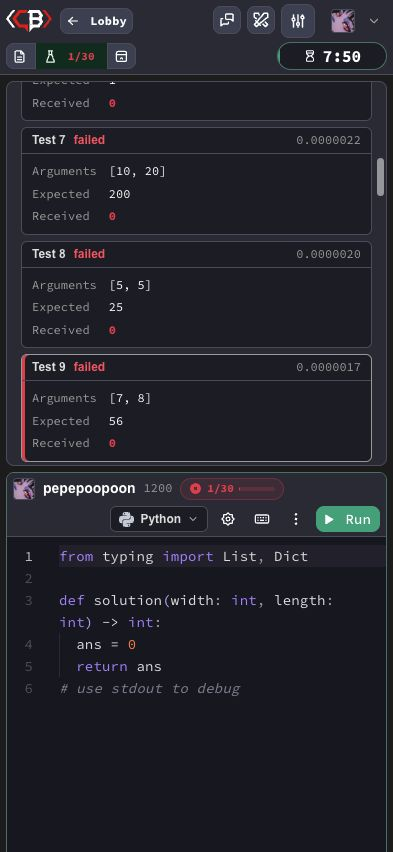

# Ручной прогон Codebattle, 27 октября 2026

Приложение: https://codebattle.hexlet.io/  
Версия: **f030dcc** ([коммит f030dcca05eb81c87a2bfbc78ec174907969504c](https://github.com/hexlet-codebattle/codebattle/commit/f030dcca05eb81c87a2bfbc78ec174907969504c)).
Версия подтверждена в футере публичной главной страницы без авторизации и в конфигурации приложения в публичном HTML. Это версия повторного прогона, версия исходного сообщения о баге не восстанавливалась.

Окружение: Chromium, macOS 15.6.1 (24G90).
Для повторной проверки мобильного дефекта использован viewport **393 × 852 CSS px** в том же браузере.

## Результаты

Из 16 подготовленных тест-кейсов выполнено 14: **14 pass, 0 fail**.
Два сценария с другим пользователем не выполнены: второй управляемый тестовый аккаунт отсутствует. В `testing-report.yml` перечислены только выполненные проверки.

| № | Проверка | Наблюдение | Результат |
|---|---|---|---|
| 1 | Авторизация GitHub | После выхода и повторного входа показаны Successfully authenticated и pepepoopoon | pass |
| 2 | Игра против бота | Создана игра 326103, показаны Codebot, задача и редакторы | pass |
| 3 | Выбор сложности | В созданной игре 326105 задача migration_weather_plan имеет уровень Hard | pass |
| 4 | Выбор задачи | В созданной игре 326103 открыта rect_area, условие о площади прямоугольника | pass |
| 5 | Выбор языка | В игре 326104 выполнено переключение JavaScript → Python, появился шаблон Python | pass |
| 6 | Редактирование кода | В игре 326104 код const x = 10; заменён на const x = 20; | pass |
| 7 | Запуск тестов | В игре 326103 неправильное решение возвращает 0, показаны результаты 1/30 | pass |
| 8 | Неправильное решение | В игре 326103 показаны 29 failed, ожидаемые и фактические значения | pass |
| 9 | Игровой чат | В чате игры с ботом 326107 видно сообщение pepepoopoon: Hello! | pass |
| 10 | Рейтинг | В Lobby открыт Leaderboard, видны имена и числовые показатели игроков | pass |
| 11 | Игра с другим пользователем и присоединение | Нет второго управляемого аккаунта | не выполнен |
| 12 | Игра с другом и присоединение | Нет второго управляемого аккаунта | не выполнен |
| 13 | Победа | Игра 326103: 30/30, You won!, игрок Won, бот Lost | pass |
| 14 | Поражение | Игра 326104: бот прошёл 30/30, You lost, игрок Lost, бот Won | pass |
| 15 | Истечение времени | Игра 326105: Hard, 1 min, без отправок решения, Time is over | pass |
| 16 | Сдача | Игра 326106: More → Give up → подтверждение, игрок Gave up, бот Won | pass |

Проверки проводились в играх против бота. Созданные игры 326103–326108 завершены.

## Доказательства исходов игры

- [Победа и результаты 30/30](bot-rect-area-win.jpg)
- [Поражение после решения бота](bot-rect-area-loss.jpg)
- [Завершение по таймеру](bot-timeout.jpg)
- [Завершение после сдачи](bot-give-up.jpg)

## Повторная проверка issue № 2362

[Исходный баг-репорт](https://github.com/hexlet-codebattle/codebattle/issues/2362) закрыт как completed после слияния [PR № 2363](https://github.com/hexlet-codebattle/codebattle/pull/2363).

Повторная проверка на f030dcc, игра 326108:

1. Создана игра против бота: Elementary, rect_area, 8 min.
2. В Python оставлено неправильное решение, возвращающее 0; выполнен Run, результат 1/30.
3. Установлен viewport 393 × 852, список результатов прокручен до теста 30.
4. Выбран тест 9; проверены его аргументы, ожидаемый и фактический результат.

Результат: при ещё активной игре (на таймере 7:50) карточка Test 9 и все её значения видны, навигация не перекрывает содержимое. **Исходный дефект не воспроизвёлся.** После снимка игра завершена через Give up.

Новые подтверждённые дефекты в этом прогоне не выявлены. `issues.yml` содержит пустой список открытых дефектов, `reopened_issues.yml` — пустой список неисправленных повторно проверенных дефектов.
